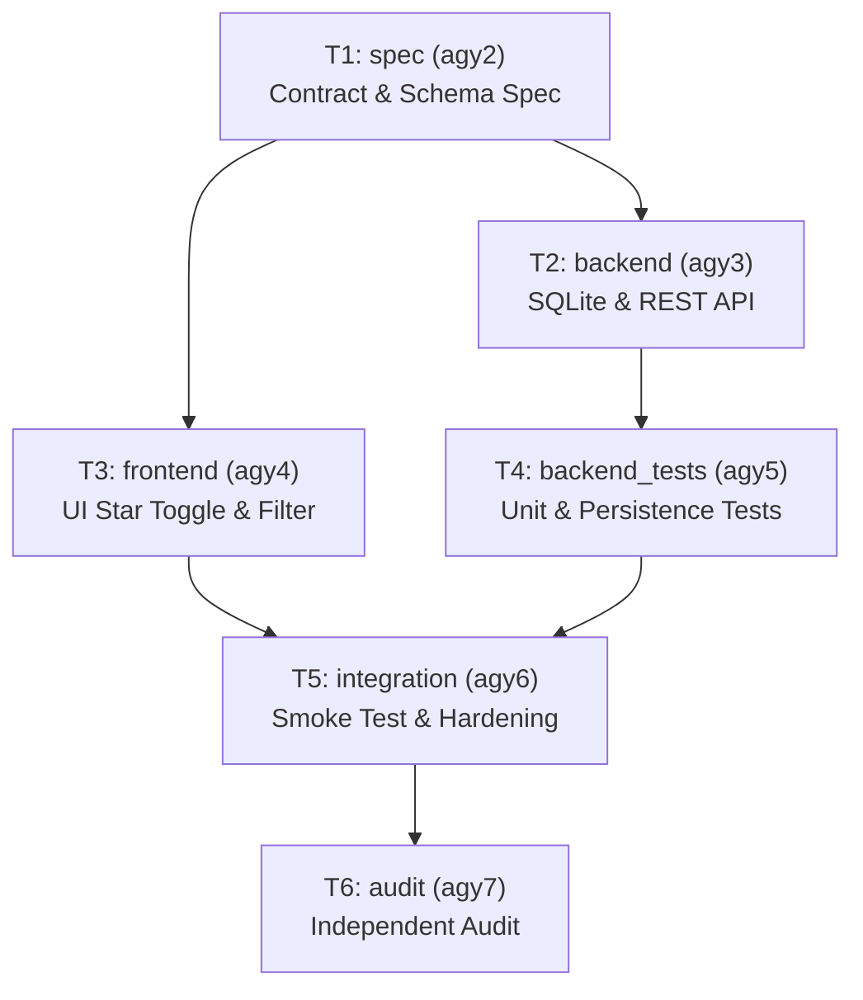

# AGY-Herdr Software Factory — v3.0.0 Certification Report

This document certifies that the AGY-Herdr Software Factory has been upgraded and verified from v2.x to **v3.0.0** in accordance with all strict requirements, architectural invariants, host isolation boundaries, deterministic fault-injection suites, and real AGY delegation workloads.

---

## 1. Executive Summary

- **Factory Version**: `3.0.0`
- **Core Architecture**: Python 3 standard library only (`tools/factory.py`, zero external packages, no `.venv`).
- **Worker Pool**: Production workers remain exclusively `agy`, `agy2`, `agy3`, `agy4`, `agy5`, `agy6`, and `agy7` operating over the user's existing Herdr control plane (`wK:p1`).
- **Execution Evidence**:
  - Deterministic Core Capability Suite: **35/35 passing tests** (`factory_tests/test_v3_capabilities.py`, `factory_tests/test_factory_core.py`).
  - MiniBoard Regression Suite: **34/34 passing unit tests**, **12/12 smoke test steps PASS**.
  - MiniLinks Certification Workload: **30/30 passing unit tests**, **12/12 smoke test steps PASS**.
  - Real AGY Execution Run: `run-20260923-043032` successfully completed the MiniLinks Favorite/Star DAG end-to-end.
  - Final Independent Audit: `agy7` conducted an independent review resulting in **0 Critical and 0 Major findings** (`APPROVED`).

---

## 2. Hard Scope Verification Matrix

| Requirement / Scenario | Specification | Method / Evidence | Result |
| :--- | :--- | :--- | :---: |
| **1. Generic WorkerAdapter Boundary** | `WorkerAdapter` base class with `AgyAdapter` as sole production implementation | `tools/factory.py` lines 426–585; registry lookup tested in `test_v3_capabilities.py` | **PASS** |
| **2. Production Worker Invariance** | Production worker identities strictly limited to `agy` through `agy7` | `factory.json` worker registry; all mapped to `adapter: agy` | **PASS** |
| **3. Arbitrary DAG Scheduler** | Dynamic dependency-driven scheduler; no wave-index hardcoding | Concurrency pool with dynamic `ready_tasks` computation; tested in `test_dag_fan_out_fan_in` | **PASS** |
| **4. Explicit State Machine** | 11 core canonical states + 5 exceptional states (`BLOCKED`, `TIMED_OUT`, `FAILED`, `CONFLICTED`, `CANCELLED`); atomic JSON writes; append-only `events.jsonl` | `tools/factory.py` `atomic_write_json`, `log_event`, canonical state updates; verified across all runs | **PASS** |
| **5. Attempt Identity & History** | Monotonically incrementing attempt ID (`att-{attempt_id}`), isolated attempt branches/worktrees, full attempt history retained | Tested in `test_v3_capabilities.py`; exercised in real run `run-20260923-043032` where `frontend` attempt 1 timed out and attempt 2 succeeded | **PASS** |
| **6. Safe Timeout Semantics** | Cancel owned workspace on timeout, retain attempt worktree for inspection, mark `TIMED_OUT` | Tested in `test_timeout_marks_timed_out_and_cleans_workspace`; real timeout handled for `frontend` attempt 1 | **PASS** |
| **7. Idempotent Reconciliation Resume** | Cases A through F handled by inspecting Git commits, branches, and status artifacts | `tools/factory.py` `reconcile_state()`; tested in `test_crash_after_commit_and_reconciliation_resume` and real resume | **PASS** |
| **8. Deterministic Failpoints** | Test-only injection via `FACTORY_TEST_FAILPOINT` (`FAIL_BEFORE_COMMIT`, `FAIL_AFTER_COMMIT`, `FAIL_BEFORE_MERGE`, etc.) | Tested in `test_crash_after_commit_and_reconciliation_resume` | **PASS** |
| **9. Git Merge Conflict Detection** | Conflict detected, diff captured, `CONFLICTED` state set, immediate `git merge --abort` | Tested in `test_merge_conflict_detected_and_aborted` with overlapping file edits | **PASS** |
| **10. Concurrent Run Isolation** | Run-scoped resource management; Run A cannot mutate or clean Run B | Tested in `test_run_scoped_resource_isolation` | **PASS** |
| **11. Strengthened Guardrails** | Directory globs, path traversal protection, symlink escape detection outside project root | Tested in `test_symlink_pointing_outside_project_detected` and `test_factory_core.py` | **PASS** |
| **12. Status Projection Contract** | `status --json` and `status --json --run <id>` exposing Kanban vocabulary (`BACKLOG`, `READY`, `RUNNING`, `BLOCKED`, `REVIEW`, `DONE`, `FAILED`) | Tested in `test_status_projection_structure` and `test_canonical_to_display_state_mapping` | **PASS** |
| **13. Real AGY End-to-End Workload** | MiniLinks Favorite/Star DAG across fixed workers `agy2` -> `agy3` + `agy4` -> `agy5` -> `agy6` -> `agy7` | Executed in `run-20260923-043032` with all tasks integrated and verified | **PASS** |
| **14. Host & Herdr Cleanliness** | 11 baseline workspaces untouched; 0 lingering owned resources; no global package installs | Verified by `list_workspaces()` and `tools/factory.py cleanup` | **PASS** |

---

## 3. Real AGY Certification Workload: MiniLinks Favorite Feature

The v3 real AGY workload was executed against `plans/minilinks_v3_favorite.json` (`run-20260923-043032`):



### Execution Chronology & Provenance
1. **`spec` (`agy2`)**:
   - Commit: `b68b8b445da17bfc9d449c7cd8dfc7fc28b2fe18`
   - Changes: `examples/minilinks/SPEC.md`
   - Outcome: Specified `is_favorite` boolean column, REST API parameters (`?favorites=true`), and UI behavior.
2. **`backend` (`agy3`) & `frontend` (`agy4`) [Parallel Fan-Out]**:
   - Concurrently dispatched at `2026-09-23T04:31:40.543503+00:00` and `2026-09-23T04:31:40.544171+00:00`.
   - `backend` finished at `04:33:59` with commit `c39bf0ac94048d468a1e6e217a689da02a12161d` (SQLite migration, filtering, JSON serialization).
   - `frontend` attempt 1 timed out after 240s; workspace `w2A` was closed cleanly without host impact.
3. **`backend_tests` (`agy5`)**:
   - Dependent on `backend`. Dispatched at `04:33:59` and finished at `04:36:11`.
   - Commit: `81bdb47a82aa3eccef48219315b61332dd1938b8`.
4. **Reconciliation Resume**:
   - Run resumed using `python3 tools/factory.py resume run-20260923-043032`.
   - `reconcile_state()` identified completed tasks (`spec`, `backend`, `backend_tests`) in Case A.
   - Handled Case F: re-dispatched `frontend` as attempt 2 (`att-2`) on `agy4` with 360s timeout.
   - `frontend` attempt 2 completed and integrated with commit `ad13cd2`.
5. **`integration` (`agy6`) [Fan-In Gate]**:
   - Unblocked once both `backend_tests` and `frontend` merged.
   - Commit: `87b95a8` updating `examples/minilinks/scripts/smoke_test.py` with favorite toggle and filter validations.
6. **`audit` (`agy7`)**:
   - Conducted independent read-only review. Status: `APPROVED`. 0 Critical / 0 Major findings.
7. **Post-Validation Gates**:
   - `minilinks_unit_tests`: 30/30 PASS
   - `minilinks_smoke_test`: 12/12 PASS
   - `miniboard_regression_tests`: 34/34 PASS
   - `factory_core_tests`: 35/35 PASS

---

## 4. Machine-Readable Status Projection Contract (v4 Kanban Ready)

The status projection contract (`tools/factory.py status --json [--run <run_id>]`) provides a clean, decoupled interface for the future `nelsonPires5/herdr-board` Kanban integration:

```json
{
  "factory_version": "3.0.0",
  "project_root": "/root/agy-herdr-factory-poc",
  "control_plane": {
    "workspace_id": "wK",
    "pane_id": "wK:p1",
    "herdr_socket": "/root/.config/herdr/herdr.sock"
  },
  "runs": [
    {
      "run_id": "run-20260923-043032",
      "plan_id": "minilinks_v3_favorite",
      "plan_name": "MiniLinks v3 Favorite/Star Bookmarks Feature DAG Orchestration Plan",
      "run_state": "COMPLETED",
      "start_time": "2026-09-23T04:30:32.834805+00:00",
      "end_time": "2026-09-23T04:54:24.120531+00:00",
      "tasks": [
        {
          "task_id": "spec",
          "canonical_state": "INTEGRATED",
          "display_state": "DONE",
          "worker_id": "agy2",
          "adapter": "agy",
          "current_attempt_id": 1,
          "attempts_count": 1,
          "dependencies": [],
          "status": "SUCCESS"
        },
        {
          "task_id": "frontend",
          "canonical_state": "INTEGRATED",
          "display_state": "DONE",
          "worker_id": "agy4",
          "adapter": "agy",
          "current_attempt_id": 2,
          "attempts_count": 2,
          "dependencies": ["spec"],
          "status": "SUCCESS"
        }
      ]
    }
  ]
}
```

### State Mapping Table
| Canonical State | Display State (Board Column) | Description |
| :--- | :--- | :--- |
| `PENDING` | `BACKLOG` | Task waiting in DAG backlog |
| `READY` | `READY` | All dependencies satisfied, ready for worker slot |
| `DISPATCHING`, `RUNNING`, `RESULT_RECEIVED` | `RUNNING` | Actively being executed in worker workspace |
| `PATH_VALIDATING`, `VALIDATING`, `COMMITTING`, `INTEGRATING` | `REVIEW` | Completed by worker, undergoing validation/integration |
| `BLOCKED`, `CONFLICTED` | `BLOCKED` | Dependent task failed or merge conflict encountered |
| `INTEGRATED`, `COMPLETED` | `DONE` | Successfully merged and verified |
| `FAILED`, `TIMED_OUT`, `CANCELLED` | `FAILED` | Attempt failed or timed out |

---

## 5. Security Boundary & Host Isolation

1. **Host Preservation**:
   - Zero packages installed globally or in `.venv`.
   - Zero modifications to system files, shell profiles, cron, or systemd.
   - Herdr server baseline preserved (all 11 baseline workspaces `wT`, `wQ`, `wE`, `wP`, `w8`, `wA`, `wS`, `wK`, `wN`, `wC`, `wD` untouched).
2. **Explicit ID Ownership Guardrail**:
   - Invariant: `if resource_id not in owned_resources: mutation_forbidden`.
   - Foreign workspaces and pre-existing panes cannot be modified, focused, or closed.
3. **Path Guardrails vs OS Sandboxing**:
   - The factory enforces strict path allowlists, expected file matching, and symlink escape checks before committing.
   - *Limitation Disclosure*: Path guardrails operate at the factory commit gate; they do NOT provide kernel/OS-level process sandboxing against intentional malicious worker escapes.

---

## 6. Verification Sign-Off

- **Factory Core Tests**: 35/35 PASS
- **MiniBoard Regressions**: 34/34 unit tests PASS, 12/12 smoke test steps PASS
- **MiniLinks Regressions**: 30/30 unit tests PASS, 12/12 smoke test steps PASS
- **Final Audit**: `agy7` approved with 0 Critical and 0 Major findings.
- **Factory State**: Ready for v4 `nelsonPires5/herdr-board` and `DroidAdapter` integration.
